# Level-1 Data Flow Diagram (DFD) Specification

## 1. Executive Summary & Purpose

This document provides the formal architectural and structural specification for the **Level-1 Data Flow Diagram (DFD)** of the synthetic **AI-Enabled Campus Information System**. The primary objective is to define the exact entities, processes, data stores, trust boundaries, and logical data flows necessary to conduct a rigorous **STRIDE** (Spoofing, Tampering, Repudiation, Information Disclosure, Denial of Service, Elevation of Privilege) threat analysis.

### DFD Semantics vs. Flowcharts
A Data Flow Diagram is **not** a procedural software flowchart or UML activity diagram:
* **Information Movement vs. Control Flow:** In this DFD, directed arrows represent the asynchronous or synchronous movement of data packets, payloads, credentials, queries, and logs between components. They do **not** represent sequential execution order, conditional branching (`if/else`), or loops.
* **Component Semantics:** 
  * **External Entities (Squares/Rectangles):** Autonomous actors or systems outside the direct control of the application boundary.
  * **Processes (Circles/Rounded Rectangles):** Software components, microservices, or computation engines that transform, validate, route, or compute data.
  * **Data Stores (Open-ended Rectangles / Parallel Lines):** Passive repositories where data rests permanently or semi-permanently.
  * **Trust Boundaries (Dashed Lines):** Perimeters dividing zones of differing security trust, privilege levels, or administrative ownership.

---

## 2. System Overview & Architecture Decomposition

The synthetic campus system is decomposed into 4 External Entities, 8 Processes (3 client portals + 5 core backend services), 4 Data Stores, and 4 Trust Boundaries, linked together by 22 Logical Data Flows.

```
       [TB1: Public/External User Zone]
       E1: Student  |  E2: Faculty  |  E3: Campus Administrator
             │             │              │
           (F01)         (F02)          (F03)
             ▼             ▼              ▼
       P1: Student   P2: Faculty    P3: Admin
           App           Portal         Portal
             │             │              │
           (F04)         (F05)          (F06)
             ▼             ▼              ▼
════════════════════════════════════════════════════════════════════════════
       [TB2: Campus Application Zone]
                    ┌────────────────────────┐
                    │    P4: API Gateway     │◄───(F20, F21, F22)───┐
                    └───────────┬────────────┘                      │
           ┌────────────┬───────┴────────┬─────────────┐            │
         (F07)        (F11)            (F15)         (F18)          │
           │            │                │             │            │
           ▼            ▼                ▼             │            │
      ┌─────────┐  ┌─────────┐      ┌─────────┐        │            │
      │ P5: Auth│  │ P6: AI  │      │ P7:     │        │            │
      │ Service │  │Assistant│      │Analytics│        │            │
      └────┬────┘  └────┬────┘      └────┬────┘        │            │
         (F08)          │                │             │            │
           └───────────┼────────────────(F17)─────────┼────────────┘
                        │                │             ▼
                        │                │        ┌─────────┐
                        │                │        │ P8: Rec │
                        │                │        │ Service │
                        │                │        └─────────┘
════════════════════════╪════════════════╪══════════════════════════════════
 [TB4: External AI]     │                │     [TB3: Protected Data Zone]
  ┌─────────────┐       │ (F14)          │ (F16)   ┌─────────────────┐
  │ E4: Cloud   │◄(F12)─┤   │            ├───┐     │ D1: Student Info│
  │ LLM Service │─(F13)─┘   │            │   └────►│ Database        │
  └─────────────┘           ▼            │         └─────────────────┘
                   ┌─────────────────┐   │         ┌─────────────────┐
                   │ D3: AI Logs &   │   ├────────►│ D2: Academic &  │
                   │ App Logs        │   │  (F10)  │ Attendance DB   │
                   └─────────────────┘   │         └─────────────────┘
                                         │ (F09)   ┌─────────────────┐
                                         └────────►│ D4: Security    │
                                            (F19)  │ Audit Logs      │
                                                   └─────────────────┘
```

---

## 3. Formal Element Inventory

### 3.1 External Entities ($E$)
External entities represent originators or terminal consumers of information residing outside the core system processes.

| Entity ID | Entity Name | Description | Trust Boundary |
| :---: | :--- | :--- | :---: |
| **E1** | **Student** | Enrolled undergraduate or postgraduate student accessing academic services, schedules, attendance, and the AI campus tutor. | `TB1` |
| **E2** | **Faculty** | Academic teaching and research staff posting grades, recording daily attendance, managing course modules, and reviewing student records. | `TB1` |
| **E3** | **Campus Administrator** | Privileged IT and academic office staff managing user provisioning, role assignments, system configurations, and security audits. | `TB1` |
| **E4** | **External Cloud AI/LLM Service** | Third-party commercial generative AI API providing high-parameter foundational language model inference via HTTPS. | `TB4` |

---

### 3.2 Processes ($P$)
Processes are computational nodes that ingest, process, transform, and dispatch information.

| Process ID | Process Name | Architectural Role & Functionality | Trust Boundary |
| :---: | :--- | :--- | :---: |
| **P1** | **Student Mobile/Web Application** | Client-side frontend rendering student dashboards, dispatching credentials, and submitting queries. | `TB1` |
| **P2** | **Faculty Web Portal** | Web-based faculty management portal handling grade submissions, attendance rosters, and class communications. | `TB1` |
| **P3** | **Administrator Portal** | High-privilege web console for campus configuration, identity lifecycle management, and security telemetry review. | `TB1` |
| **P4** | **API Gateway** | Central campus ingress controller: terminates TLS, performs initial request validation, token verification, rate limiting, and route routing. | `TB2` |
| **P5** | **Authentication and Authorization Service** | Identity provider verifying credentials, issuing signed tokens (JWT), evaluating RBAC permissions, and managing session state. | `TB2` |
| **P6** | **Campus AI Assistant** | Conversational agent orchestrating campus query handling, prompt sanitization, RAG context assembly, and external LLM dispatch. | `TB2` |
| **P7** | **Student Analytics Service** | Batch and stream processing engine computing student academic risk metrics, engagement trends, and GPA forecasts. | `TB2` |
| **P8** | **Recommendation Service** | Machine-learning-based suggestion engine generating personalized elective options, remedial interventions, and academic resources. | `TB2` |

---

### 3.3 Data Stores ($D$)
Data stores represent stateful persistence tiers storing operational, historical, and security records.

| Store ID | Data Store Name | Contained Data Assets | Sensitivity | Trust Boundary |
| :---: | :--- | :--- | :---: | :---: |
| **D1** | **Student Information Database** | Student PII, residential addresses, contact numbers, guardian details, enrollment status, financial payment flags. | High (Confidential) | `TB3` |
| **D2** | **Academic and Attendance Database** | Official course marks, GPA/CGPA calculations, semester transcript history, biometric attendance rosters. | Critical (Integrity-Critical) | `TB3` |
| **D3** | **AI Conversation and Application Logs** | Historical user prompt dialogues, AI completion outputs, token usage statistics, session context tokens. | Medium-High (Privacy-Sensitive) | `TB3` |
| **D4** | **Security Audit Logs** | Append-only security event trail: failed auth attempts, role escalations, administrative actions, and gateway access records. | Critical (Non-Repudiation) | `TB3` |

---

### 3.4 Trust Boundaries ($TB$)
Trust boundaries partition the architecture into distinct privilege, ownership, and network security domains.

| Boundary ID | Boundary Name | Description & Security Perimeter |
| :---: | :--- | :--- |
| **TB1** | **Public/External User Zone** | Separates unauthenticated end users (`E1`, `E2`, `E3`) and their personal client devices/browsers (`P1`, `P2`, `P3`) from the campus network. Carried over public untrusted internet and cellular networks. |
| **TB2** | **Campus Application Zone** | Encapsulates the private campus microservices subnet hosting `P4`, `P5`, `P6`, `P7`, and `P8`. Shielded behind reverse proxies and perimeter firewalls. |
| **TB3** | **Protected Data Zone** | High-security internal enclave containing persistence databases (`D1`–`D4`). Isolated via internal database firewalls, requiring mutual authentication and least-privilege service accounts. |
| **TB4** | **External AI Service Boundary** | Demarcates the perimeter between the campus internal infrastructure (`P6`) and the third-party cloud provider (`E4`). Transits public WAN egress requiring rigorous egress data sanitization. |

---

## 4. Comprehensive Logical Data Flows ($F01$ – $F22$)

The system contains exactly 22 formal data flows. Every flow possesses an explicit source, destination, payload description, and crosses specific trust boundaries.

| Flow ID | Source Component | Destination Component | Data Flow Payload & Description | Crossed Boundary |
| :---: | :--- | :--- | :--- | :---: |
| **F01** | `E1: Student` | `P1: Student Mobile/Web Application` | Student credentials, profile requests, academic queries, and AI chatbot prompts entered via keyboard/touch. | None (Within `TB1`) |
| **F02** | `E2: Faculty` | `P2: Faculty Web Portal` | Faculty login credentials, student grading rubrics, attendance marks, and course update requests. | None (Within `TB1`) |
| **F03** | `E3: Campus Administrator` | `P3: Administrator Portal` | Administrative credentials, role assignment directives, system configuration parameters, and audit query commands. | None (Within `TB1`) |
| **F04** | `P1: Student Mobile/Web Application` | `P4: API Gateway` | HTTPS API requests: student login packets, course schedule requests, chatbot queries, bearer tokens. | Crosses `TB1` $\rightarrow$ `TB2` |
| **F05** | `P2: Faculty Web Portal` | `P4: API Gateway` | HTTPS API requests: faculty authentication, grade submissions, roster updates, bearer tokens. | Crosses `TB1` $\rightarrow$ `TB2` |
| **F06** | `P3: Administrator Portal` | `P4: API Gateway` | High-privilege HTTPS administrative API requests: policy changes, account provisioning, telemetry inspection. | Crosses `TB1` $\rightarrow$ `TB2` |
| **F07** | `P4: API Gateway` | `P5: Authentication and Authorization Service` | Ingress authentication challenges, login credentials verification requests, and token authorization validation queries. | Within `TB2` |
| **F08** | `P5: Authentication and Authorization Service` | `P4: API Gateway` | Identity verification responses, cryptographically signed JWT bearer tokens, RBAC permission claims, session validity. | Within `TB2` |
| **F09** | `P4: API Gateway` | `D1: Student Information Database` | Authenticated database queries: fetch student profile, update contact information, query demographic data. | Crosses `TB2` $\rightarrow$ `TB3` |
| **F10** | `P4: API Gateway` | `D2: Academic and Attendance Database` | Authenticated database transactions: record daily attendance, post exam grades, fetch academic transcripts. | Crosses `TB2` $\rightarrow$ `TB3` |
| **F11** | `P4: API Gateway` | `P6: Campus AI Assistant` | Routed student and faculty natural language prompts, session IDs, and context parameters. | Within `TB2` |
| **F12** | `P6: Campus AI Assistant` | `E4: External Cloud AI/LLM Service` | Pre-processed prompt context, sanitized student queries, system instructions transmitted over external HTTPS WAN. | Crosses `TB2` $\rightarrow$ `TB4` |
| **F13** | `E4: External Cloud AI/LLM Service` | `P6: Campus AI Assistant` | Generative AI completions, natural language answers, inference metadata returned via external HTTPS WAN. | Crosses `TB4` $\rightarrow$ `TB2` |
| **F14** | `P6: Campus AI Assistant` | `D3: AI Conversation and Application Logs` | Asynchronous log payloads: conversation transcripts, prompt tokens, latency metrics, user feedback ratings. | Crosses `TB2` $\rightarrow$ `TB3` |
| **F15** | `P4: API Gateway` | `P7: Student Analytics Service` | Academic performance signals, portal activity logs, course completion events dispatched for analytical ingestion. | Within `TB2` |
| **F16** | `P7: Student Analytics Service` | `D1: Student Information Database` | Batch analytics queries: historical cohort demographic retrieval, student retention feature extraction. | Crosses `TB2` $\rightarrow$ `TB3` |
| **F17** | `P7: Student Analytics Service` | `P8: Recommendation Service` | Computed student analytics feature vectors, performance risk scores, learning trajectory metrics. | Within `TB2` |
| **F18** | `P8: Recommendation Service` | `P4: API Gateway` | Personalized elective suggestions, academic support recommendations, study path rankings for user delivery. | Within `TB2` |
| **F19** | `P4: API Gateway` | `D4: Security Audit Logs` | API/security events: security telemetry, authentication results, authorization failures, and administrative access records. | Crosses `TB2` $\rightarrow$ `TB3` |
| **F20** | `P4: API Gateway` | `P1: Student Mobile/Web Application` | HTTPS API response payloads: student profile data, attendance percentages, grades, AI chatbot answers. | Crosses `TB2` $\rightarrow$ `TB1` |
| **F21** | `P4: API Gateway` | `P2: Faculty Web Portal` | HTTPS API response payloads: class rosters, grade submission confirmations, department academic analytics. | Crosses `TB2` $\rightarrow$ `TB1` |
| **F22** | `P4: API Gateway` | `P3: Administrator Portal` | HTTPS API response payloads: system operational status, user audit logs, account management confirmations. | Crosses `TB2` $\rightarrow$ `TB1` |

---

## 5. Architectural Correctness and Diagrammatic Rules

To guarantee academic rigor and prevent common DFD modeling errors, the following architectural invariants are enforced:

1. **Conservation of Data (No Black Holes or Miracles):**
   * *No Black Holes:* Every process and data store produces at least one outgoing flow or audit telemetry stream (`F19`).
   * *No Miracles:* No process or data store generates data spontaneously without receiving an input flow.
2. **Direct Entity-to-Store Prohibition:**
   * External Entities (`E1`–`E4`) never read from or write directly to Data Stores (`D1`–`D4`). All data access is mediated by client applications (`P1`–`P3`) and core services (`P4`–`P8`).
3. **Direct Store-to-Store Prohibition:**
   * Data stores do not communicate directly with each other. Movement of data between databases is always mediated by an active compute process (e.g., `P7`).
4. **Boundary Traversal Accounting:**
   * Every flow crossing a trust boundary (`TB1`, `TB3`, `TB4`) is flagged as a high-scrutiny interception vector in the STRIDE matrix.

---

## 6. Draw.io & OWASP Threat Dragon Modeling Guide

### 6.1 Draw.io Layout Canvas & Grid Blueprint
When constructing the visual diagram in Draw.io:
* **Page Setup:** Standard Landscape A3 or A4 canvas with 10mm grid snapping enabled.
* **Zone Containers (Trust Boundaries):**
  * `TB1 (Public Zone)`: Place at top third ($Y: 40\text{mm} - 120\text{mm}$). Border style: Dashed `#FF5722`, Fill: `#FFF3E0` with 20% opacity.
  * `TB2 (Campus App Zone)`: Place at middle third ($Y: 140\text{mm} - 280\text{mm}$). Border style: Dashed `#2196F3`, Fill: `#E3F2FD` with 15% opacity.
  * `TB3 (Protected Data Zone)`: Place at bottom-right ($X: 180\text{mm} - 380\text{mm}, Y: 300\text{mm} - 420\text{mm}$). Border style: Dashed `#4CAF50`, Fill: `#E8F8F5` with 20% opacity.
  * `TB4 (External AI Boundary)`: Place at bottom-left ($X: 20\text{mm} - 140\text{mm}, Y: 300\text{mm} - 400\text{mm}$). Border style: Dashed `#9C27B0`, Fill: `#F3E5F5` with 20% opacity.
* **Component Styling:**
  * External Entities (`E1`–`E4`): Sharp rectangles, dark border, header label (e.g., `E1: Student`).
  * Processes (`P1`–`P8`): Rounded rectangles or circles, numbered identifier prefix.
  * Data Stores (`D1`–`D4`): Classic database cylinder or double-horizontal parallel line shape.
  * Connectors (`F01`–`F22`): Orthogonal or curved connectors with labeled IDs and payload summaries.

### 6.2 OWASP Threat Dragon Model Mapping
When importing into OWASP Threat Dragon:
* Create a New Threat Model titled `"STRIDE-Based Threat Modelling of an AI Campus System"`.
* In the Diagram view, add 4 External Entities, 8 Processes, 4 Stores, and 4 Boundaries.
* Draw connectors matching `F01` through `F22`.
* Threat Dragon will automatically prompt for STRIDE categories based on element types:
  * Entities $\rightarrow$ Spoofing, Repudiation.
  * Processes $\rightarrow$ Spoofing, Tampering, Repudiation, Information Disclosure, Denial of Service, Elevation of Privilege.
  * Data Stores $\rightarrow$ Tampering, Information Disclosure, Denial of Service.
  * Data Flows $\rightarrow$ Tampering, Information Disclosure, Denial of Service.

---

## 7. Complete Mermaid Data Flow Diagram

```mermaid
flowchart TB
    %% Trust Boundary 1: Public / External User Zone
    subgraph TB1["TB1: Public / External User Zone"]
        E1["E1: Student"]
        E2["E2: Faculty"]
        E3["E3: Campus Administrator"]
        
        P1["P1: Student Mobile/Web Application"]
        P2["P2: Faculty Web Portal"]
        P3["P3: Administrator Portal"]
        
        E1 -->|F01: Credentials, Requests, AI Queries| P1
        E2 -->|F02: Credentials, Academic Requests| P2
        E3 -->|F03: Admin Credentials, Mgmt Requests| P3
    end

    %% Trust Boundary 2: Campus Application Zone
    subgraph TB2["TB2: Campus Application Zone"]
        P4["P4: API Gateway"]
        P5["P5: Authentication & Authorization Service"]
        P6["P6: Campus AI Assistant"]
        P7["P7: Student Analytics Service"]
        P8["P8: Recommendation Service"]
        
        P1 -->|F04: Student API Requests| P4
        P2 -->|F05: Faculty API Requests| P4
        P3 -->|F06: Admin API Requests| P4
        
        P4 -->|F07: Auth Challenges & Requests| P5
        P5 -->|F08: Auth Token / Claims| P4
        
        P4 -->|F11: Student/Faculty AI Requests| P6
        P4 -->|F15: Student Activity & Academic Data| P7
        P7 -->|F17: Analytics Features & Risks| P8
        P8 -->|F18: Personalized Recommendations| P4
        
        P4 -->|F20: Student API Responses| P1
        P4 -->|F21: Faculty API Responses| P2
        P4 -->|F22: Admin API Responses| P3
    end

    %% Trust Boundary 4: External AI Service Boundary
    subgraph TB4["TB4: External AI Service Boundary"]
        E4["E4: External Cloud AI/LLM Service"]
    end
    
    P6 -->|F12: Sanitized Prompt & Context| E4
    E4 -->|F13: Generative AI Completion| P6

    %% Trust Boundary 3: Protected Data Zone
    subgraph TB3["TB3: Protected Data Zone"]
        D1[("D1: Student Information Database")]
        D2[("D2: Academic & Attendance Database")]
        D3[("D3: AI Conversation & App Logs")]
        D4[("D4: Security Audit Logs")]
    end

    P4 -->|F09: Student Info Queries/Updates| D1
    P4 -->|F10: Academic & Attendance Updates| D2
    P6 -->|F14: AI Interaction Logs & Metadata| D3
    P7 -->|F16: Analytics Data Retrieval| D1
    
    %% Audit Telemetry (F19)
    P4 -->|F19: API/security events| D4

    %% Styling
    style TB1 fill:#fff8e1,stroke:#ffa000,stroke-width:2px,stroke-dasharray: 5 5;
    style TB2 fill:#e1f5fe,stroke:#0288d1,stroke-width:2px,stroke-dasharray: 5 5;
    style TB3 fill:#e8f5e9,stroke:#388e3c,stroke-width:2px,stroke-dasharray: 5 5;
    style TB4 fill:#f3e5f5,stroke:#7b1fa2,stroke-width:2px,stroke-dasharray: 5 5;
    
    style E1 fill:#ffffff,stroke:#333333,stroke-width:1.5px;
    style E2 fill:#ffffff,stroke:#333333,stroke-width:1.5px;
    style E3 fill:#ffffff,stroke:#333333,stroke-width:1.5px;
    style E4 fill:#fce4ec,stroke:#c2185b,stroke-width:1.5px;
    
    style P1 fill:#ffffff,stroke:#0288d1,stroke-width:1.5px;
    style P2 fill:#ffffff,stroke:#0288d1,stroke-width:1.5px;
    style P3 fill:#ffffff,stroke:#0288d1,stroke-width:1.5px;
    style P4 fill:#b3e5fc,stroke:#0277bd,stroke-width:2px;
    style P5 fill:#b3e5fc,stroke:#0277bd,stroke-width:1.5px;
    style P6 fill:#d1c4e9,stroke:#512da8,stroke-width:1.5px;
    style P7 fill:#b3e5fc,stroke:#0277bd,stroke-width:1.5px;
    style P8 fill:#b3e5fc,stroke:#0277bd,stroke-width:1.5px;

    style D1 fill:#c8e6c9,stroke:#2e7d32,stroke-width:1.5px;
    style D2 fill:#c8e6c9,stroke:#2e7d32,stroke-width:1.5px;
    style D3 fill:#c8e6c9,stroke:#2e7d32,stroke-width:1.5px;
    style D4 fill:#ffcdd2,stroke:#c62828,stroke-width:2px;
```


