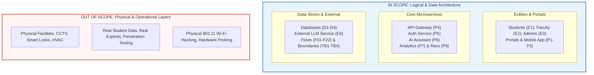

# Threat Model Scope

## 1. Project Objective and Context

The micro-project **"STRIDE-Based Threat Modelling of an AI Campus System"** investigates cybersecurity threats, architectural vulnerabilities, and recommended controls for a synthetic higher-education IT ecosystem augmented with artificial intelligence. 

To maintain academic rigor and analytical depth within the Data Security and Privacy course, this document formally establishes the boundaries of the threat-modeling engagement. It explicitly demarcates what architectural components, communication pathways, threat categories, and operational layers fall **within scope** versus those that are explicitly **out of scope**.

---

## 2. In-Scope Components and Activities

The threat model rigorously evaluates the logical architecture, data flows, communication protocols, and access control boundaries across the synthetic campus system.

### 2.1 User Personas and Client Access Interfaces
* **Student Access (`E1` $\rightarrow$ `P1`):** Student authentication, mobile/web portal interactions, profile queries, attendance views, and AI assistant dialogues.
* **Faculty Access (`E2` $\rightarrow$ `P2`):** Faculty web portal sessions, grade posting, attendance tracking, course administration, and academic advisory functions.
* **Campus Administrator Access (`E3` $\rightarrow$ `P3`):** System configuration, user account provisioning, role assignments, security policy administration, and audit inspection.

### 2.2 Core Backend Services and Microservices
* **API Gateway (`P4`):** Centralized ingress management, TLS termination, API routing, rate limiting, and request sanitization.
* **Authentication and Authorization Service (`P5`):** Identity verification, token generation (JWT/Opaque sessions), multi-factor challenges, and role-based access validation.
* **Campus AI Assistant (`P6`):** Orchestration of student/faculty prompt processing, context assembly, guardrail filtering, and dialogue dispatch.
* **Student Analytics Service (`P7`):** Predictive student progress modeling, academic risk flag computation, and feature vector extraction.
* **Recommendation Service (`P8`):** Personalized elective recommendations, academic pathway suggestions, and student resource targeting.

### 2.3 Data Storage Repositories
* **Student Information Database (`D1`):** Confidential synthetic biographical, contact, and enrollment data.
* **Academic and Attendance Database (`D2`):** Course marks, transcripts, degree audits, and daily attendance records.
* **AI Conversation and Application Logs (`D3`):** Synthetic historical query logs, contextual prompt buffers, and AI responses.
* **Security Audit Logs (`D4`):** Centralized audit trail capturing security events, failed authentications, privilege changes, and administrative actions.

### 2.4 Third-Party Integrations and External Boundaries
* **External Cloud AI / LLM Service (`E4`):** Third-party hosted large language model API endpoints, public internet egress, prompt delivery, and inference response ingestion across `TB4`.

### 2.5 Logical Data Flows and Trust Boundaries
* All twenty-two formal data flows (`F01` through `F22`).
* All four defined trust boundaries:
  * `TB1 - Public/External User Zone`
  * `TB2 - Campus Application Zone`
  * `TB3 - Protected Data Zone`
  * `TB4 - External AI Service Boundary`

### 2.6 Methodological Scope
* Systematic STRIDE application (Spoofing, Tampering, Repudiation, Information Disclosure, Denial of Service, Elevation of Privilege).
* Threat identification across all components and flows.
* 3×3 Qualitative Risk Assessment (Likelihood × Impact).
* Architectural security control recommendations (Preventive, Detective, Corrective).

---

## 3. Out-of-Scope Components and Activities

The following domains are explicitly excluded from this academic threat modeling project to prevent scope creep, maintain focus on software and data privacy architecture, and uphold ethical/legal standards:

| Out-of-Scope Area | Exclusion Justification and Rationale |
| :--- | :--- |
| **Physical Campus Security** | Physical locks, biometric turnstiles, server room gates, and perimeter fencing are managed by facility management and fall outside software/data architecture. |
| **CCTV & Surveillance Infrastructure** | Campus video surveillance and closed-circuit monitoring systems operate on isolated broadcast or analog networks not integrated into the logical campus data plane. |
| **Building Access Control Systems** | Physical smartcard RFID badge readers for dorms and classroom doors are decoupled from the cloud/web campus information system. |
| **Power, HVAC, and Electrical Grid** | Facility electrical redundancy, UPS backup systems, and data center thermal regulation are outside the logical threat model. |
| **Real Penetration Testing & Exploitation** | No intrusive active scanning, vulnerability probing, packet injection, or fuzzing is conducted against live systems. |
| **Real Student / Institutional Data** | Zero real student, faculty, or staff PII, grades, or credentials are used; all data structures and records are 100% synthetic. |
| **Production Cloud Deployment & CI/CD** | Infrastructure-as-code scripting (Terraform, Ansible), Kubernetes cluster orchestration, and production release pipelines are not modeled. |
| **Malware, Ransomware & Exploit Payload Dev** | The project models theoretical attack scenarios; developing active malicious binaries, rootkits, or payload scripts is prohibited. |
| **Wireless Layer (Layer 1/2) Attacks** | 802.11 Wi-Fi deauthentication attacks, rogue AP evil twin attacks, and RF jamming on physical campus grounds are excluded. |
| **Hardware-Level Attacks** | Side-channel attacks (Spectre/Meltdown), hardware security module (HSM) tampering, bus probing, and physical RAM tapping are excluded. |

---

## 4. Scope Governance Matrix

